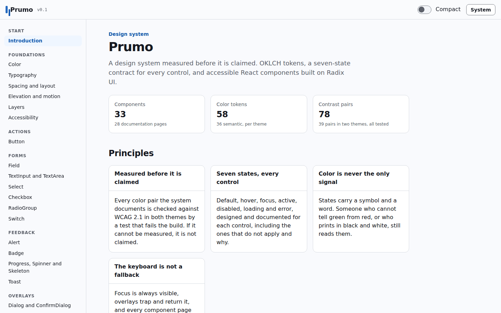
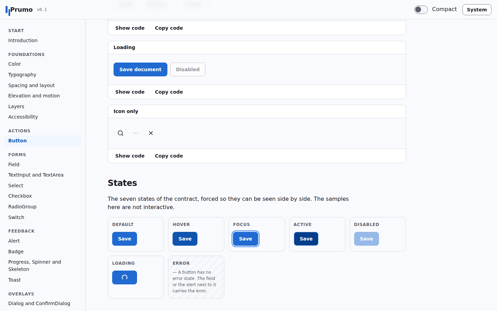
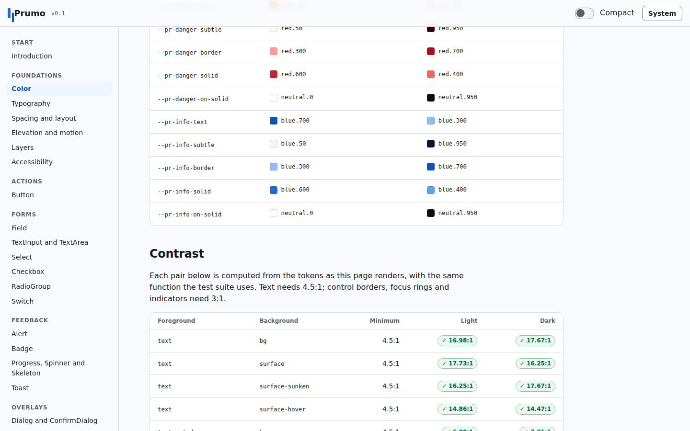
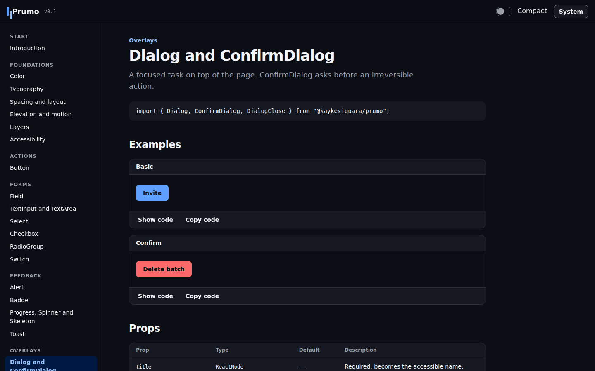
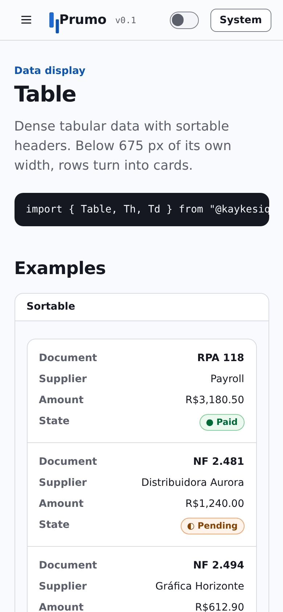

# Prumo

A design system measured before it is claimed. OKLCH tokens with light and dark themes, a seven-state contract for every control, and 33 accessible React components built on Radix UI, with a documentation site that computes its own contrast numbers.

[Leia em português](README.pt-BR.md)



## Why "Prumo"

A *prumo* is a plumb line: the weight on a string that builders use to check that a wall is straight. It does not guess. That is the idea here. Every color pair the system documents is checked against WCAG 2.1 in both themes, every color is fitted to the sRGB gamut, and every control is designed in seven states. When something cannot be measured, the system does not claim it.

## What is in it

**Tokens.** `tokens/tokens.json`, in the W3C Design Tokens format, is the single source. `npm run tokens` turns it into CSS custom properties, TypeScript and a Tailwind CSS v4 theme. It holds:

- 58 palette colors in OKLCH, with neutrals on hue 266;
- 36 semantic tokens per theme, light and dark;
- type, space, radius, control height, shadow and motion scales;
- five breakpoints: 360, 675, 1024, 1440 and 1920;
- a named z-index scale: menu, sticky, backdrop, modal, toast, tooltip;
- a compact density that lowers every control at once.

**Components.** 33 of them, all headless-accessible and styled with the tokens:

| Group | Components |
| --- | --- |
| Actions | Button, IconButton |
| Forms | Field, TextInput, TextArea, Select, Checkbox, RadioGroup, Switch |
| Feedback | Alert, Badge, Progress, Spinner, Skeleton, Toast |
| Overlays | Dialog, ConfirmDialog, Sheet, Popover, Tooltip, Menu |
| Navigation | Tabs, Breadcrumb, Pagination, Link |
| Data display | Table, Card, Stat, Avatar, EmptyState, Kbd |
| Layout | Stack, VisuallyHidden |

**Documentation.** A site built with Prumo itself, in English and Portuguese, with a PT/EN button in the header. It follows the browser's language on the first visit and remembers the choice. It has:

- one page per component, with live examples whose code is read from the example file, so the two never drift apart. The Portuguese examples also pass the translated labels the components accept, such as `closeLabel` and `previousLabel`;
- the seven states side by side, a props table, the keyboard and accessibility notes;
- foundation pages for color, type, space, elevation and motion, layers and accessibility, with contrast and distance computed from the tokens as the page renders.



## Decisions worth reading

**Seven states, including the ones that do not apply.** Every control is designed in default, hover, focus, active, disabled, loading and error. When a state does not apply, the documentation says so and says why: a button has no error state, because the field or the alert next to it carries the error. The gap is a decision, not an oversight.

**Loading keeps the label.** A loading button keeps its text for screen readers and keeps its width, so the layout does not jump. It stays focusable and ignores clicks, so focus is not lost mid-action.

**Contrast and gamut fail the build.** `src/tokens/tokens.test.ts` checks the 39 documented pairs in both themes and checks that every palette color fits sRGB. The gamut check matters: a color written outside it is clamped by the browser, so the color that ships is not the one that was measured.

**Readability and distinguishability are different questions.** Contrast answers whether text can be read. Whether a warning can be told apart from an error in a dense table is a distance in OKLab. No standard sets a pass mark for it, so the color page shows it as a measurement to compare before and after, not as a pass or a fail.

**Color is never the only signal.** Status badges carry a symbol and a word. Errors carry a symbol, hidden from screen readers so it is not read twice.

**Layers have names.** A component asks for the modal layer, not for `z-index: 9999`. Toasts sit above modals, because a confirmation can arrive while a dialog is open. Tooltips sit above everything.

**The table responds to its own width.** Below 675 px of container width, rows become cards with the column name before each value. It is a container query, so it works wherever the table is placed.

**Native where native is right.** Select is a real `<select>`, so keyboards and mobile pickers behave as people expect. Checkbox and radio keep the native input underneath the styling.

| Contrast, computed live | Dark theme | Mobile |
| --- | --- | --- |
|  |  |  |

## Use it

```bash
npm install github:KaykeSiquara/prumo
```

Not on the npm registry yet: this installs straight from GitHub and builds the
library on install. Imports stay `@kaykesiquara/prumo`.

```tsx
import "@kaykesiquara/prumo/styles.css";
import { Button, Field, TextInput } from "@kaykesiquara/prumo";

<Field label="Amount" description="Use a period for the cents." error={error}>
  <TextInput inputMode="decimal" />
</Field>
<Button variant="primary" loading={saving}>Save document</Button>
```

- Themes follow the system. Set `data-pr-theme="light"` or `"dark"` on any element to force one.
- Set `data-pr-density="compact"` for denser controls.
- With Tailwind CSS v4, import `@kaykesiquara/prumo/tailwind.css` after Tailwind to get utilities such as `bg-surface` and `text-danger-text`.
- The styles live in CSS cascade layers (`prumo.tokens`, `prumo.base`, `prumo.components`), so your own CSS wins without fighting specificity.

## Develop

```bash
npm install
npm run dev          # documentation at http://localhost:5173
npm test
npm run tokens       # regenerate CSS, TypeScript and Tailwind from tokens.json
npm run build        # documentation site in dist/docs
npm run build:lib    # the package in dist/lib and dist/types
```

The package is 9.6 KB of JavaScript and 6.3 KB of CSS, gzipped, with React and Radix UI as external dependencies.

## Tests

242 tests with Vitest and Testing Library:

- tokens: 138 (every palette color in gamut, every documented pair in both themes);
- components: 27, written against roles, accessible names and the keyboard;
- documentation: 77, including axe on every page in both languages, the language switch, and a check that every page, prop, key and example is translated.

CI checks that the generated token files match `tokens.json`, then runs the type check, the tests and both builds on Node 22 and 24.

## Structure

```
tokens/tokens.json     the source of every token
scripts/               the token build, with no dependencies
src/components/        the components and their tests
src/styles/            generated tokens, base styles and component styles
src/tokens/            generated TypeScript, color math and the contrast test
docs/                  the documentation site, its examples and its tests
```

## Deploy the documentation

On Vercel, import the repository. `vercel.json` sets the build command, the output folder and the rewrites for client-side routing.

## License

MIT
