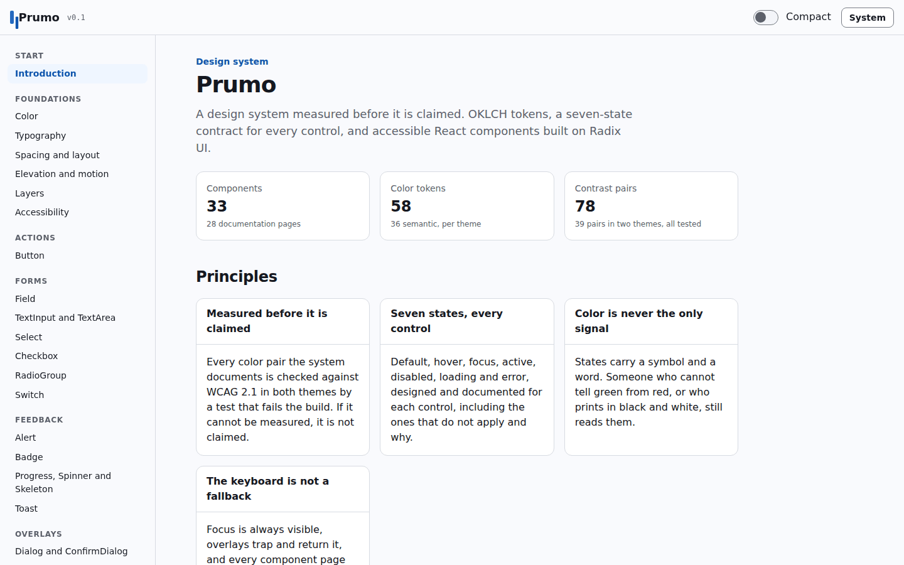
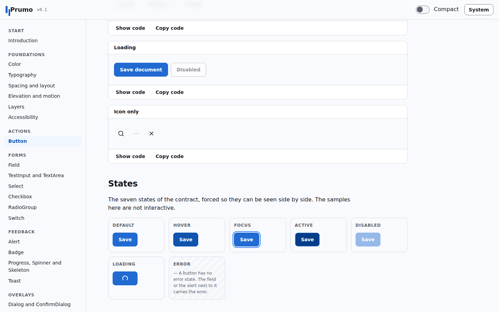
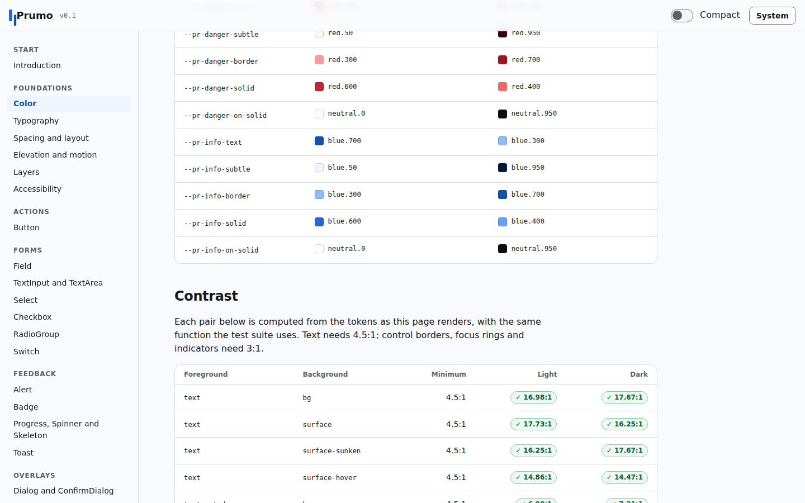
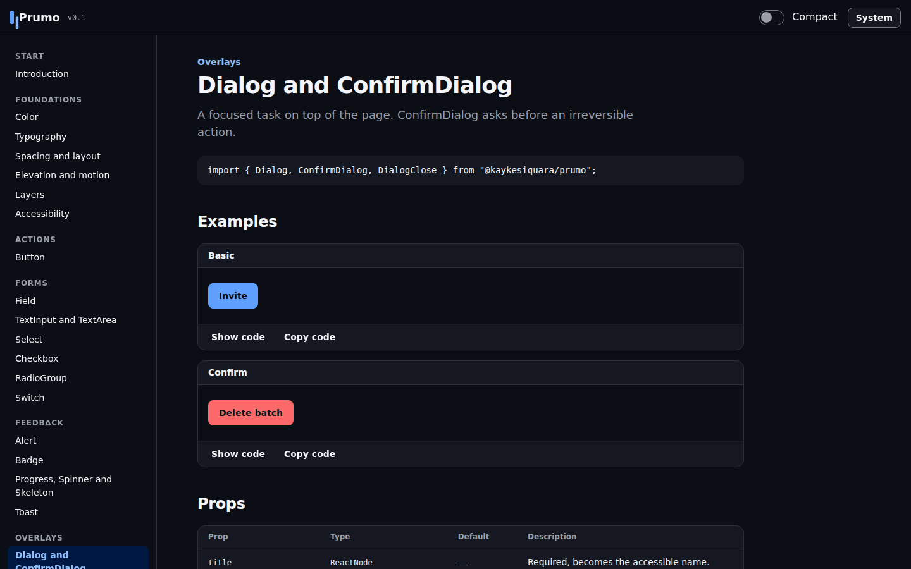
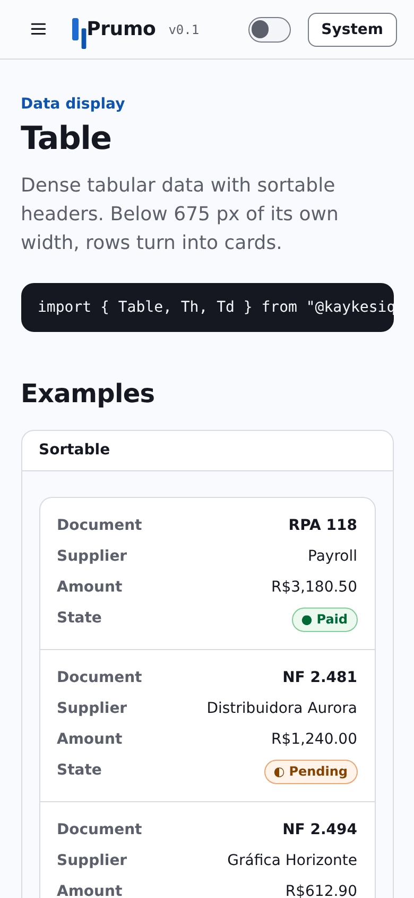

# Prumo

Um design system medido antes de afirmado. Tokens em OKLCH com tema claro e escuro, um contrato de sete estados para cada controle e 33 componentes React acessíveis construídos sobre o Radix UI, com um site de documentação que calcula os próprios números de contraste.

[Read in English](README.md)



## Por que "Prumo"

O prumo é o fio com um peso que o pedreiro usa para conferir se a parede está reta. Ele não chuta. A ideia aqui é essa. Todo par de cores que o sistema documenta é conferido contra a WCAG 2.1 nos dois temas, toda cor é ajustada ao gamut sRGB, e todo controle é desenhado em sete estados. Quando algo não pode ser medido, o sistema não afirma.

## O que tem

**Tokens.** O `tokens/tokens.json`, no formato W3C Design Tokens, é a fonte única. O `npm run tokens` transforma o arquivo em variáveis CSS, TypeScript e um tema para o Tailwind CSS v4. Ele contém:

- 58 cores em OKLCH, com os neutros na matiz 266;
- 36 tokens semânticos por tema, claro e escuro;
- escalas de tipografia, espaçamento, raio, altura de controle, sombra e movimento;
- cinco faixas de tela: 360, 675, 1024, 1440 e 1920;
- uma escala de z-index com nomes: menu, header fixo, backdrop, modal, toast e tooltip;
- uma densidade compacta que reduz todos os controles de uma vez.

**Componentes.** São 33, todos acessíveis e estilizados pelos tokens:

| Grupo | Componentes |
| --- | --- |
| Ações | Button, IconButton |
| Formulários | Field, TextInput, TextArea, Select, Checkbox, RadioGroup, Switch |
| Feedback | Alert, Badge, Progress, Spinner, Skeleton, Toast |
| Sobrepostos | Dialog, ConfirmDialog, Sheet, Popover, Tooltip, Menu |
| Navegação | Tabs, Breadcrumb, Pagination, Link |
| Exibição de dados | Table, Card, Stat, Avatar, EmptyState, Kbd |
| Layout | Stack, VisuallyHidden |

**Documentação.** Um site feito com o próprio Prumo, em inglês e português, com um botão PT/EN no cabeçalho. Na primeira visita ele segue o idioma do navegador e depois lembra a escolha. Ele tem:

- uma página por componente, com exemplos vivos cujo código é lido do próprio arquivo do exemplo, então os dois nunca divergem. Os exemplos em português também passam os rótulos traduzidos que os componentes aceitam, como `closeLabel` e `previousLabel`;
- os sete estados lado a lado, a tabela de propriedades, o teclado e as notas de acessibilidade;
- páginas de fundamentos para cor, tipografia, espaçamento, elevação e movimento, camadas e acessibilidade, com contraste e distância calculados a partir dos tokens enquanto a página renderiza.



## Decisões que valem a leitura

**Sete estados, inclusive os que não se aplicam.** Todo controle é desenhado em default, hover, focus, active, disabled, loading e error. Quando um estado não se aplica, a documentação diz e explica: um botão não tem estado de erro, porque o campo ou o alerta ao lado carrega o erro. A lacuna é uma decisão, não um esquecimento.

**O carregamento mantém o rótulo.** Um botão carregando mantém o texto para o leitor de tela e mantém a largura, então o layout não pula. Ele continua focável e ignora cliques, para o foco não se perder no meio da ação.

**Contraste e gamut derrubam o build.** O `src/tokens/tokens.test.ts` confere os 39 pares documentados nos dois temas e confere se toda cor da paleta cabe no sRGB. A checagem de gamut importa: uma cor escrita fora dele é recortada pelo navegador, então a cor que vai para a tela não é a que foi medida.

**Legibilidade e distinção são perguntas diferentes.** Contraste responde se o texto pode ser lido. Se um aviso pode ser distinguido de um erro numa tabela densa é uma distância em OKLab. Nenhuma norma define um valor mínimo para ela, então a página de cor mostra essa distância como medida para comparar antes e depois, e não como aprovação ou reprovação.

**Cor nunca é o único sinal.** Os selos de estado têm símbolo e palavra. Os erros têm um símbolo, oculto para o leitor de tela para não ser lido duas vezes.

**As camadas têm nome.** Um componente pede a camada de modal, não `z-index: 9999`. O toast fica acima do modal, porque uma confirmação pode chegar com um diálogo aberto. O tooltip fica acima de tudo.

**A tabela responde à própria largura.** Abaixo de 675 px de largura do contêiner, as linhas viram cartões com o nome da coluna antes de cada valor. É uma container query, então funciona onde quer que a tabela seja colocada.

**Nativo onde nativo é o certo.** O Select é um `<select>` de verdade, então teclado e os seletores do celular funcionam como as pessoas esperam. Checkbox e rádio mantêm o input nativo por baixo do estilo.

| Contraste calculado ao vivo | Tema escuro | Celular |
| --- | --- | --- |
|  |  |  |

## Como usar

```bash
npm install github:KaykeSiquara/prumo
```

Ainda não está no registro do npm: o comando instala direto do GitHub e gera a
biblioteca na instalação. Os imports continuam `@kaykesiquara/prumo`.

```tsx
import "@kaykesiquara/prumo/styles.css";
import { Button, Field, TextInput } from "@kaykesiquara/prumo";

<Field label="Valor" description="Use ponto para os centavos." error={erro}>
  <TextInput inputMode="decimal" />
</Field>
<Button variant="primary" loading={salvando}>Salvar documento</Button>
```

- Os temas seguem o sistema. Use `data-pr-theme="light"` ou `"dark"` em qualquer elemento para forçar um.
- Use `data-pr-density="compact"` para controles mais densos.
- Com Tailwind CSS v4, importe `@kaykesiquara/prumo/tailwind.css` depois do Tailwind para ter utilitários como `bg-surface` e `text-danger-text`.
- Os estilos ficam em camadas de cascata (`prumo.tokens`, `prumo.base`, `prumo.components`), então o seu CSS vence sem briga de especificidade.

## Desenvolvimento

```bash
npm install
npm run dev          # documentação em http://localhost:5173
npm test
npm run tokens       # regera CSS, TypeScript e Tailwind a partir do tokens.json
npm run build        # site de documentação em dist/docs
npm run build:lib    # o pacote em dist/lib e dist/types
```

O pacote tem 9,6 KB de JavaScript e 6,3 KB de CSS, comprimidos, com React e Radix UI como dependências externas.

## Testes

242 testes com Vitest e Testing Library:

- tokens: 138 (toda cor da paleta dentro do gamut, todo par documentado nos dois temas);
- componentes: 27, escritos sobre papéis, nomes acessíveis e teclado;
- documentação: 77, incluindo o axe em cada página nos dois idiomas, a troca de idioma e uma checagem de que toda página, propriedade, tecla e exemplo está traduzido.

O CI confere se os arquivos gerados dos tokens batem com o `tokens.json` e depois roda a checagem de tipos, os testes e os dois builds em Node 20 e 22.

## Estrutura

```
tokens/tokens.json     a fonte de todo token
scripts/               o build dos tokens, sem dependências
src/components/        os componentes e os testes deles
src/styles/            tokens gerados, estilos base e estilos dos componentes
src/tokens/            TypeScript gerado, cálculo de cor e o teste de contraste
docs/                  o site de documentação, os exemplos e os testes
```

## Publicar a documentação

Na Vercel, importe o repositório. O `vercel.json` define o comando de build, a pasta de saída e o redirecionamento das rotas.

## Licença

MIT
